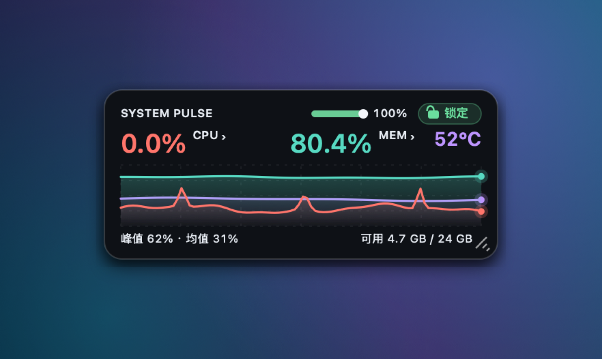
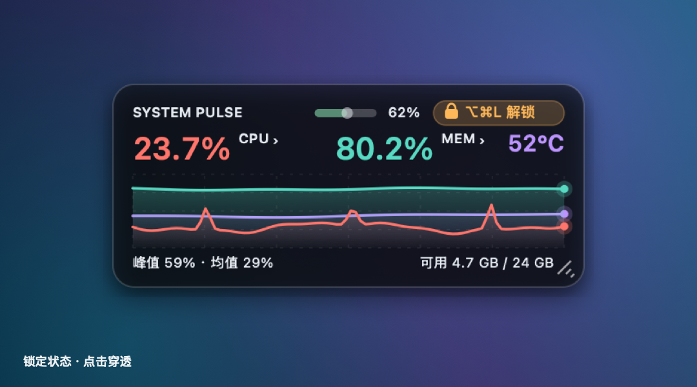
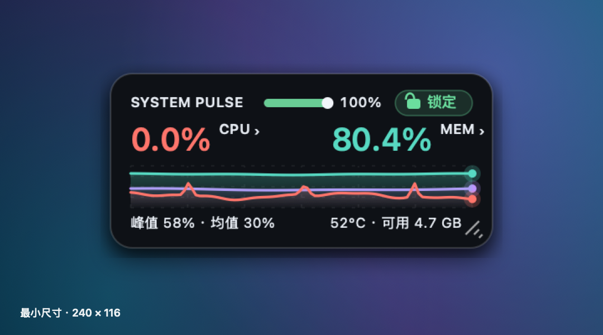
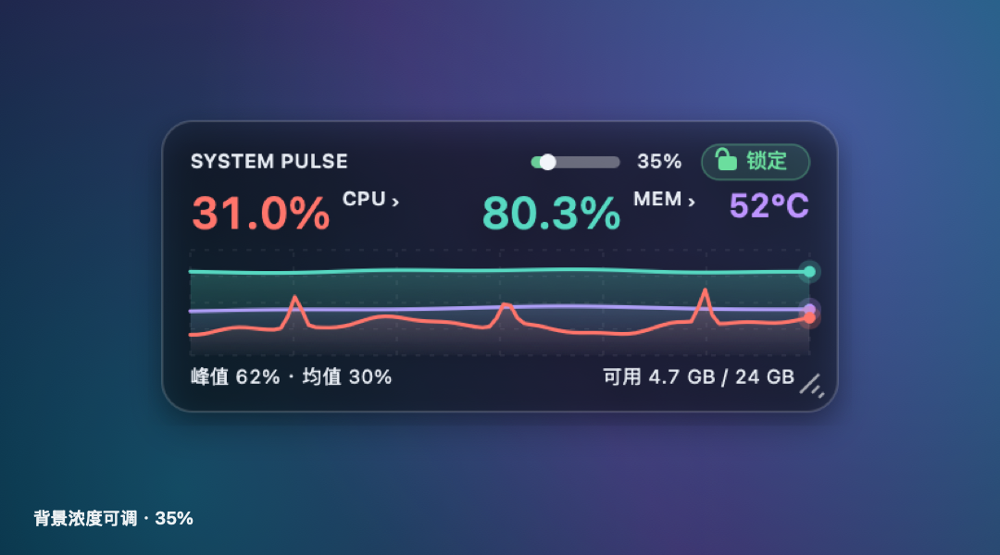
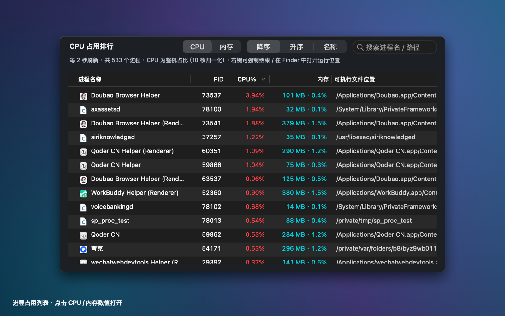

# SystemPulse

A native macOS transparent floating window that shows live **CPU / memory / SoC temperature** with heartbeat-style sparklines. Freely draggable and resizable, adjustable opacity, and one click to lock it so every mouse click passes straight through to the window underneath. **Click the CPU or memory number to open a process list** with sortable usage, search, and force-quit actions.

[简体中文](README.md) · **English**



> Pure Swift 5 + AppKit with a little C. No third-party dependencies, no Xcode project, no network calls, no permission prompts. Universal binary for Apple Silicon and Intel Macs (macOS 11.0+).

---

## Features

| | |
| --- | --- |
| Live sampling | System-wide CPU usage, memory usage and used/total bytes, refreshed every second |
| Temperature | CPU / SoC die temperature in °C (purple number and sparkline), sampled every 3 seconds |
| Heartbeat chart | Red = CPU, cyan = memory, purple = temperature; scrolling lines with gradient fills and glowing end points |
| Always-on details | `peak xx% · avg xx%` and `x.x GB free / xx GB`, still visible at the smallest window size |
| Transparent panel | Borderless rounded window, dark/light appearance, background opacity from 20% to 100%; **text and lines stay fully opaque and never fade with the background** |
| Drag & resize | Grab any edge, corner, or the bottom-right grip (minimum 240×116); position and size are remembered |
| Lock / unlock | When locked, clicks pass through and the panel ignores the mouse entirely; unlock with `⌥⌘L` or the menu bar |
| On-window controls | Mini opacity slider and lock button in the title row, with a live opacity percentage |
| Process list | Click the CPU / memory number to open a separate window with **descending / ascending / name** sorting, live search, refreshed every 2 seconds |
| Right-click a process | Force quit, graceful terminate, reveal the app in Finder, open the app, copy name / PID / full path |
| Menu bar | ECG icon with live `CPU% · MEM% · temp`; menu for show/hide, always-on-top, opacity presets, appearance, reset position, process list, quit |

| Default | Locked |
| --- | --- |
|  |  |

| Minimum size 240×116 | Background opacity 35% |
| --- | --- |
|  |  |



---

## Download & install

Grab **`SystemPulse-1.1.0-macOS.zip`** from the [Releases page](https://github.com/xiaohe4966/SystemPulse/releases/latest), unzip it, drop `SystemPulse.app` into `/Applications`, and double-click. An ECG icon appears in the menu bar.

> **"App is damaged and can't be opened"?**
> The app is ad-hoc signed — there is no Apple Developer ID signature or notarization. Run
> `xattr -cr /Applications/SystemPulse.app`
> once in Terminal to remove the download quarantine flag, then open it again. Alternatively, right-click the app in Finder → Open → Open. If you'd rather not, just build from source as shown below; the result is identical.

To uninstall: quit from the menu bar icon and move `SystemPulse.app` to the Trash. Clear saved preferences with `defaults delete local.systempulse.monitor`.

---

## Usage

| Action | Result |
| --- | --- |
| Drag an empty area of the panel | Move the window |
| Drag an edge, a corner, or the bottom-right grip | Resize in eight directions |
| Drag the slider in the title row | Adjust background opacity (20%–100%), with a live percentage |
| Click the green **锁定 / Lock** button | Lock instantly; the button turns orange and reads `⌥⌘L 解锁` |
| Press `⌥⌘L`, or menu bar icon → **解锁悬浮窗 / Unlock** | Unlock and restore dragging / resizing |
| Click the CPU or memory percentage (there is a small `›` after it) | Open the process list for that metric |
| Menu bar → **按 CPU 占用排序… / 按内存占用排序…** | Open the list even while the panel is locked or hidden |
| Menu bar menu | Show/hide, always on top, opacity presets, dark/light, reset position and size, quit |

**About locking**: locking sets `ignoresMouseEvents`, so every click goes through to the window below and the panel stops responding to the mouse — including its own lock button and slider. That is intentional: "locked" means *nothing* on the panel reacts. Unlocking therefore lives outside the panel (menu bar + global hotkey), and the locked button puts the shortcut right in its label as a reminder.

> If macOS hides the menu bar icon, `⌥⌘L` still unlocks. You can also run `defaults delete local.systempulse.monitor` and restart to reset everything.

---

## Process list

Click the CPU or memory percentage on the panel (a small `›` follows the number and a subtle highlight appears on hover), or use the menu bar → **按 CPU 占用排序…** / **按内存占用排序…**. The list is a separate window that can be moved, resized and closed; its position and size are remembered.

| | |
| --- | --- |
| Five columns | Process name (with icon), PID, CPU%, memory (MB/GB + share), full executable path |
| Switch metric | `CPU` / `内存` segmented control, or click the `CPU%` / `内存` column header |
| Three sort modes | `降序` (descending, default), `升序` (ascending), `名称` (by name A–Z); column headers work too |
| Search | Live filter by process name or path in the top-right search field |
| Refresh | Every 2 seconds; CPU is an instantaneous delta between two samples, not a lifetime average |
| Right-click menu | **强制结束** (SIGKILL, with confirmation), **正常退出** (SIGTERM), **在 Finder 中显示运行位置** (reveal in Finder), open the app, open the containing folder, copy name / PID / full path, refresh now |
| Double-click a row | Reveal that process in Finder |

"Reveal in Finder" prefers the outermost `.app` in the executable path (so a Chrome Helper points at the main app); plain command-line processes select the executable itself.

> **Units**: per-process CPU% is normalised by the logical core count so it matches the panel's system-wide CPU% — the values roughly add up to total CPU. This differs from Activity Monitor, which reports percentage of a single core and can exceed 100%. Memory uses resident physical memory (RSS) divided by total RAM.
>
> Force-quit only works on processes your account is allowed to signal; protected/other-user processes report an error. `kernel_task`, PID ≤ 1 and SystemPulse itself cannot be terminated from the list.

---

## Build from source

You only need macOS and the Xcode Command Line Tools (`xcode-select --install`). No Xcode project, SwiftPM, or CocoaPods.

```bash
git clone https://github.com/xiaohe4966/SystemPulse.git
cd SystemPulse

./build.sh            # Universal build (arm64 + x86_64), ready to share
./build.sh --run      # Build and launch
./build.sh --native   # Current architecture only, faster
```

The output is `SystemPulse.app` next to the script (ad-hoc signed). The script compiles the C temperature probe with `clang`, builds both architectures with `swiftc`, and merges them with `lipo`. `--run` and `--native` can be combined.

CI runs the exact same `./build.sh`; see [.github/workflows/build.yml](.github/workflows/build.yml).

---

## How it works

| File | Role |
| --- | --- |
| `Sources/main.swift` | AppKit entry point; `LSUIElement` app with no Dock icon |
| `Sources/AppDelegate.swift` | `NSStatusItem` menu bar, lock state, Carbon global hotkey `⌥⌘L`, `UserDefaults` persistence |
| `Sources/PulseWindow.swift` | Borderless transparent `NSPanel`, CoreGraphics drawing, hit regions for move / 8-way resize / slider / button / clickable numbers |
| `Sources/SystemMonitor.swift` | `host_statistics(HOST_CPU_LOAD_INFO)` CPU tick deltas; `host_statistics64(HOST_VM_INFO64)` treats free + inactive pages as available memory |
| `Sources/ProcessMonitor.swift` | `libproc` (`proc_listallpids` / `PROC_PIDTASKINFO` / `proc_pidpath`) process enumeration, Mach absolute-time deltas for instantaneous CPU, RSS for memory, cached app names and `.app` paths |
| `Sources/ProcessListController.swift` | Process `NSWindow` + `NSTableView`: metric switch, three sort modes, search, context menu, force quit and Finder reveal |
| `Sources/TemperatureMonitor.swift` | 3-second throttle/cache so sensors aren't enumerated every second |
| `Sources/TemperatureProbe.c/.h` | Reads temperature through IOKit HID sensors (C layer) |

**About temperature**: Apple exposes no public CPU temperature API, and the SMC keys from the Intel era don't apply to Apple Silicon. SystemPulse uses the IOKit HID sensor channel: it matches `PrimaryUsagePage = 0xff00 (AppleVendor)` / `PrimaryUsage = 0x0005 (temperature sensor)`, reads `kIOHIDEventTypeTemperature` events from each service, skips battery / gas gauge sensors, and reports the highest die temperature. These are private symbols resolved at runtime with `dlsym` — **nothing is linked against a private API statically** — and each event object is released immediately after reading.

If no sensor can be read (for example on an Intel Mac, or after a future macOS update changes the interface), the temperature number and purple line **hide themselves automatically**; CPU and memory keep working. The value is the hottest SoC die sensor, mapped to the chart over 30–80 °C; treat it as a reference, not an official Apple temperature metric.

**About process data**: `pti_total_user + pti_total_system` from `PROC_PIDTASKINFO` is a cumulative Mach absolute-time counter. Dividing its delta by the `mach_absolute_time()` delta between two samples and by the logical core count yields an instantaneous, system-normalised CPU share. Numerator and denominator share the same time unit, so no `mach_timebase_info` conversion is needed and the maths holds on both Apple Silicon and Intel. Names come from `NSRunningApplication.localizedName`, paths from `proc_pidpath`, and the `.app` location from `bundleURL` or the outermost `.app` in the path. Everything uses public `libproc` / AppKit APIs — no root, Accessibility or Full Disk Access permission.

---

## Privacy

Everything comes from local system counters. No network access, no uploads, no logs, and no Accessibility / Full Disk Access / root permissions. The process list only displays local names, PIDs, CPU/memory and executable paths — nothing is uploaded or written to disk. The global hotkey uses Carbon `RegisterEventHotKey`, which also needs no Accessibility authorization.

## Known limitations

- No Developer ID signature or notarization, so the quarantine flag must be cleared on first launch.
- As an `LSUIElement` app there is no Dock icon or main menu; quit from the menu bar icon.
- Temperature is the hottest SoC die sensor, and sensor names/counts vary by model — indicative only.
- Minimum window size is 240×116; smaller would crush the text.
- Process CPU% is normalised to the whole machine (see above), unlike Activity Monitor's per-core figures.
- Force quit is subject to macOS permissions; processes owned by other users or protected by the system may return `EPERM`.
- The in-app UI text (buttons and menu items) is Chinese only; this README lists the English equivalents.

## License

[MIT](LICENSE) © 2026 xiaohe4966
