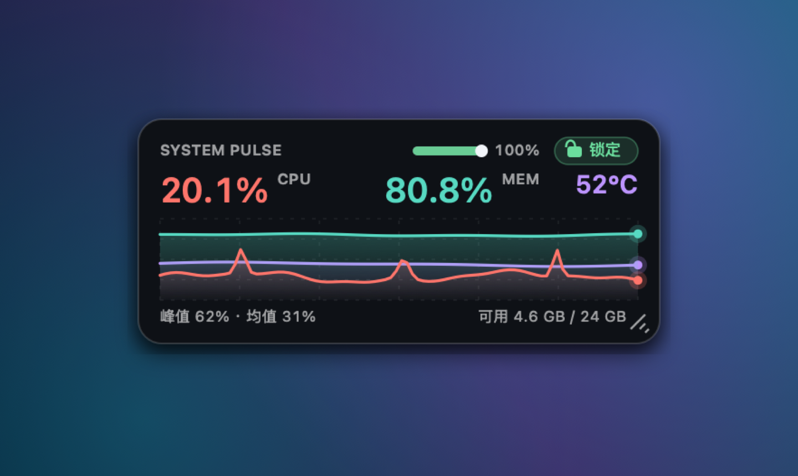
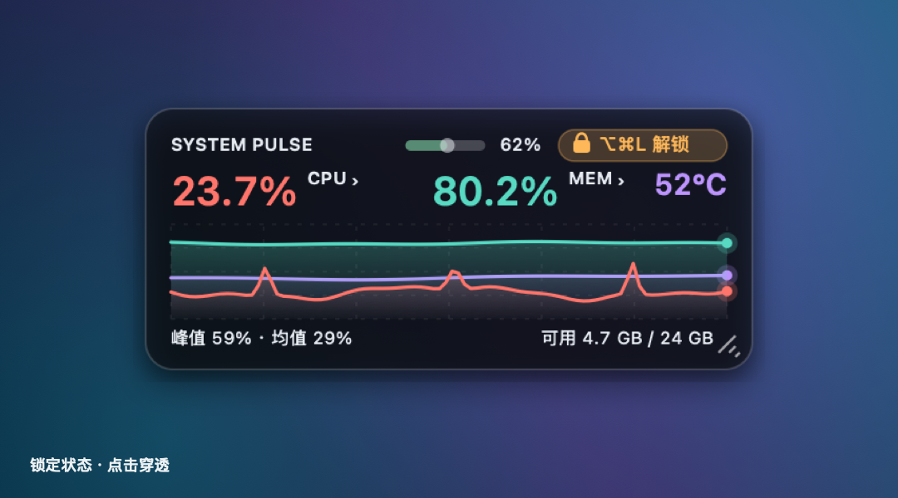
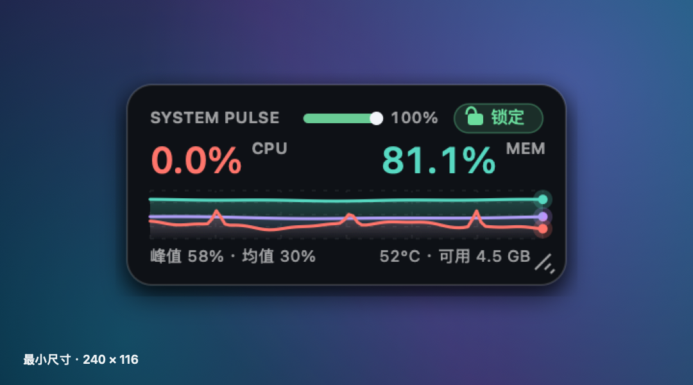
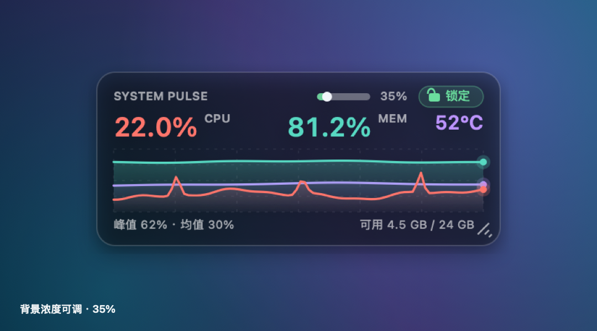
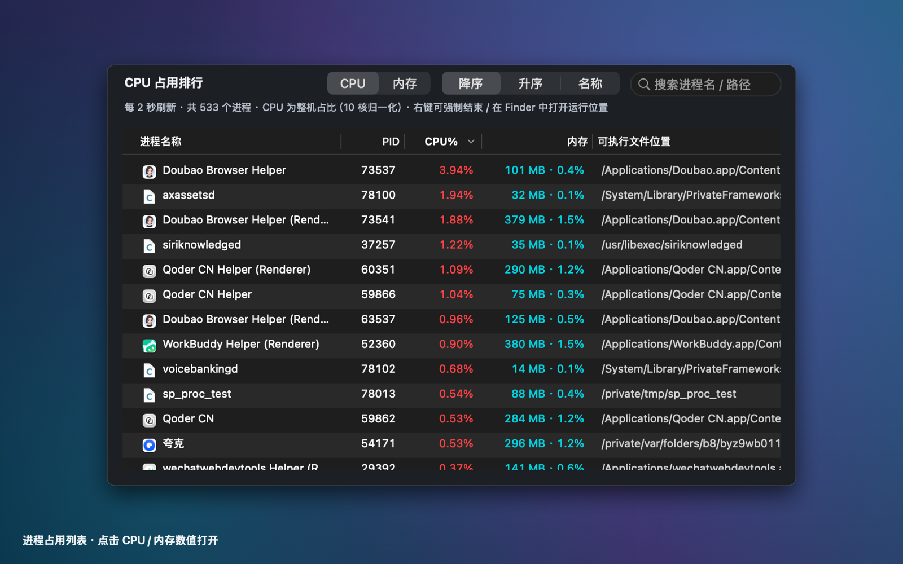
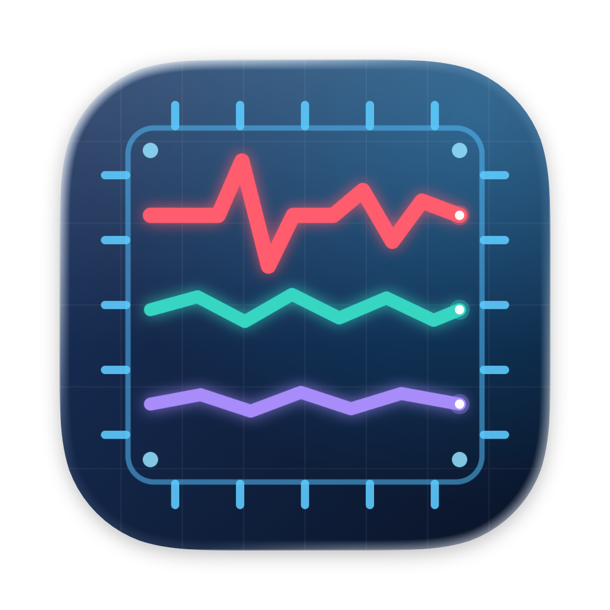

# SystemPulse

macOS 原生透明悬浮窗，实时显示 **CPU / 内存 / SoC 温度** 和心跳式走势图。可随意拖动缩放、调节透明度；一键锁定后，鼠标点击完全穿透到下面的窗口。**点击 CPU / 内存数字还能展开进程占用排行**：降序、升序、按名字排列，右键强制结束或定位软件运行位置。

**简体中文** · [English](README.en.md)



> 纯 Swift 5 + AppKit + 少量 C，无第三方依赖、无 Xcode 工程、无网络请求、不申请任何系统权限。Universal 二进制，Apple Silicon 与 Intel Mac 都能跑（macOS 11.0+）。

---

## 功能一览

| 项目 | 说明 |
| --- | --- |
| 实时采样 | 整机 CPU 使用率、内存使用率与已用/总量，每秒刷新一次 |
| 温度 | CPU / SoC die 温度（紫色折线与数字），3 秒采样一次 |
| 心跳走势图 | 红＝CPU、青＝内存、紫＝温度，滚动折线 + 渐变填充 + 末端亮点 |
| 常驻小字 | `峰值 xx% · 均值 xx%`、`可用 x.x GB / xx GB`，窗口缩到最小也不消失 |
| 透明悬浮窗 | 无边框圆角面板，深色/浅色外观，背景浓度 20%~100% 任意拖动；**文字与折线始终实心，不随背景一起变淡** |
| 拖动缩放 | 拖四边、四角或右下角手柄任意调整大小（最小 240×116）；位置与尺寸自动保存 |
| 锁定 / 解锁 | 锁定后点击穿透，浮窗完全不响应鼠标；`⌥⌘L` 或菜单栏解锁 |
| 窗内控件 | 顶部迷你透明度滑杆 + 锁定按钮，右侧实时显示浓度百分比 |
| 进程占用排行 | 点击 CPU / 内存数字弹出独立列表，**降序 / 升序 / 名称**三种排列、可按进程名或路径搜索，每 2 秒刷新 |
| 右键进程 | 强制结束、正常退出、在 Finder 中显示运行位置、打开应用、复制名称 / PID / 完整路径 |
| 菜单栏 | 心电图图标实时显示 `CPU% · 内存% · 温度`，菜单里可显示/隐藏、置顶、切换外观、重置位置、打开进程列表、退出 |
| 应用图标 | 程序化绘制的 macOS 圆角方形图标：芯片 + 三条彩色走势线；三种风格可选，小尺寸自动简化 |

| 默认界面 | 锁定状态 |
| --- | --- |
|  |  |

| 最小尺寸 240×116 | 背景浓度 35% |
| --- | --- |
|  |  |



---

## 应用图标



App 图标完全由 `tools/MakeAppIcon/main.swift` 用 CoreGraphics 现画，不引入任何图片素材：深蓝玻璃质感的 macOS 圆角方形 + 芯片内框与简化引脚，红 / 青 / 紫三条折线分别对应悬浮窗里的 CPU / 内存 / 温度。`build.sh` 会自动生成 16~1024 共 10 档 PNG、合成 `AppIcon.icns` 放进 `.app`，所以从源码编译也能得到同一个图标。

16 / 32 / 64px 档会自动去掉网格、引脚和彩色细节，只保留一条加粗心跳线，缩到 Finder 列表或菜单栏尺寸依然清晰可辨。

内置三款风格，编译时用环境变量切换（1024×1024 预览见 [design/candidates/](design/candidates/)）：

```bash
SYSTEMPULSE_ICON_STYLE=chip    ./build.sh   # 芯片·玻璃（默认）
SYSTEMPULSE_ICON_STYLE=pulse   ./build.sh   # 三色脉冲（去掉芯片框）
SYSTEMPULSE_ICON_STYLE=minimal ./build.sh   # 极简心跳（蓝色底 + 单条白线）
```

> 这是 `LSUIElement` 菜单栏程序，不显示 Dock 图标；新图标会出现在 Finder、Spotlight、活动监视器和各类系统对话框里。菜单栏里仍是独立的模板心电图小图标（锁定时变橙色）。

---

## 下载与安装

到 [Releases](https://github.com/xiaohe4966/SystemPulse/releases/latest) 下载 **`SystemPulse-1.2.0-macOS.zip`**，解压后把 `SystemPulse.app` 拖进 `/Applications`（Finder 里能看到芯片图标），双击运行即可。启动后菜单栏右上角会出现心电图图标。

> **首次打开提示"已损坏，无法打开"？**
> 这个 App 使用 ad-hoc 签名，没有 Apple Developer ID 签名与公证。在终端执行一次
> `xattr -cr /Applications/SystemPulse.app`
> 清除下载隔离标记后再打开即可；也可以在 Finder 里 **右键 App → 打开 → 打开**。
> 不放心的话，直接按下面的方式从源码自己编译，效果完全一样。

卸载：菜单栏图标 → 退出，然后把 `SystemPulse.app` 丢进废纸篓。偏好设置可用 `defaults delete local.systempulse.monitor` 清空。

---

## 操作说明

| 操作 | 效果 |
| --- | --- |
| 拖窗口中间空白处 | 移动窗口 |
| 拖四边 / 四角 / 右下角斜线手柄 | 八方向缩放 |
| 拖顶部滑杆 | 调背景浓度（20%~100%），旁边实时显示百分比 |
| 点右上角绿色「锁定」 | 立即锁定，按钮变橙并显示 `⌥⌘L 解锁` |
| 按 `⌥⌘L` 或点菜单栏图标 → 「解锁悬浮窗」 | 解锁，恢复拖动与缩放 |
| 点 CPU 或内存百分比数字（后面有个小 `›`） | 弹出对应的进程占用排行窗口 |
| 菜单栏 → 「按 CPU 占用排序…」/「按内存占用排序…」 | 锁定 / 隐藏悬浮窗时也能打开进程列表 |
| 菜单栏菜单 | 显示/隐藏、始终置顶、背景浓度快捷档、深色/浅色、恢复默认位置与大小、退出 |

**关于锁定**：锁定后窗口设为 `ignoresMouseEvents`，点击任何位置都直接穿透到下层窗口，连窗内的锁定按钮和滑杆也会一起失效——这是刻意的设计，用来保证"锁定后点击悬浮窗没有任何反应"。因此解锁入口放在菜单栏和全局热键上，锁定按钮会直接把快捷键写在自己脸上提醒你。

> 万一菜单栏图标被 macOS 折叠隐藏，仍可用 `⌥⌘L` 解锁；也可以执行 `defaults delete local.systempulse.monitor` 后重启恢复默认设置。

---

## 进程占用列表

点击悬浮窗上的 CPU 或内存百分比（数字后面有个小 `›`，鼠标悬停会有浅色高亮），或者从菜单栏 →「按 CPU 占用排序…」/「按内存占用排序…」打开。列表是独立窗口，可以移动、缩放、关闭，位置与尺寸会自动记住。

| 项目 | 说明 |
| --- | --- |
| 五种列 | 进程名称（带应用图标）、PID、CPU%、内存（MB/GB + 占比）、可执行文件完整路径 |
| 切换维度 | 顶部 `CPU` / `内存` 分段控件；也可以直接点表头 `CPU%` / `内存` 切换 |
| 三种排序 | `降序`（默认，占用最高在最上）、`升序`、`名称`（A~Z）；点相应表头也能切换 |
| 搜索 | 右上角搜索框按进程名或路径实时过滤 |
| 刷新 | 每 2 秒一次；CPU 是两次采样的瞬时差值，不是进程启动以来的平均值 |
| 右键菜单 | **强制结束**（SIGKILL，带二次确认）、**正常退出**（SIGTERM）、**在 Finder 中显示运行位置**、打开这个应用、打开可执行文件所在文件夹、复制进程名称 / PID / 完整路径、立即刷新 |
| 双击一行 | 直接在 Finder 中显示该进程的运行位置 |

「运行位置」优先定位可执行文件外层最靠外的 `.app`（例如 Chrome Helper 会定位到主程序），所以能直接看到软件本体；非 App 的命令行进程则选中可执行文件本身。

> **口径说明**：进程 CPU% 按整机逻辑核数归一化，与悬浮窗的整机 CPU% 是同一口径，所有进程加起来约等于整机占用；与「活动监视器」按单核计算（可超过 100%）的口径不同。内存用常驻物理内存 RSS / 总内存计算。
>
> 强制结束只能终止当前用户有权操作的进程；系统保护进程或权限不足时会弹出错误提示，`kernel_task`、PID ≤ 1 和 SystemPulse 自身不允许被结束。

---

## 自己编译

只需要 macOS 与 Xcode Command Line Tools（`xcode-select --install`），不需要 Xcode 工程、SwiftPM 或 CocoaPods。

```bash
git clone https://github.com/xiaohe4966/SystemPulse.git
cd SystemPulse

./build.sh            # 编译 Universal（arm64 + x86_64），可直接分发
./build.sh --run      # 编译后立刻启动
./build.sh --native   # 只编译当前机器架构，更快
SYSTEMPULSE_ICON_STYLE=pulse ./build.sh   # 可选：换用另一款应用图标
```

产物是同目录下的 `SystemPulse.app`（已 ad-hoc 签名）。脚本会用 `clang` 编译温度探针的 C 代码，再用 `swiftc` 把两个架构的 Swift 产物用 `lipo` 合并；应用图标也在这一步现场绘制并合成 `AppIcon.icns`。`--run` 和 `--native` 可以组合使用。

CI 里也跑同一条 `./build.sh`，见 [.github/workflows/build.yml](.github/workflows/build.yml)。

---

## 实现原理

| 文件 | 作用 |
| --- | --- |
| `Sources/main.swift` | AppKit 入口；`LSUIElement` 应用，不占 Dock |
| `Sources/AppDelegate.swift` | `NSStatusItem` 菜单栏、锁定状态、Carbon 全局热键 `⌥⌘L`、`UserDefaults` 偏好持久化 |
| `Sources/PulseWindow.swift` | 无边框透明 `NSPanel`，CoreGraphics 自绘面板与折线，鼠标命中区实现移动 / 八方向缩放 / 滑杆 / 按钮 / 数值点击 |
| `Sources/SystemMonitor.swift` | `host_statistics(HOST_CPU_LOAD_INFO)` 用两次 tick 差值算 CPU；`host_statistics64(HOST_VM_INFO64)` 把 free + inactive 页视为可用内存，其余算已用 |
| `Sources/ProcessMonitor.swift` | `libproc`（`proc_listallpids` / `PROC_PIDTASKINFO` / `proc_pidpath`）枚举进程，Mach 绝对时间差值算瞬时 CPU，RSS 算内存占比，缓存应用名与 `.app` 路径 |
| `Sources/ProcessListController.swift` | 进程列表 `NSWindow` + `NSTableView`：维度切换、三种排序、搜索、右键菜单、强制结束与 Finder 定位 |
| `Sources/TemperatureMonitor.swift` | 温度 3 秒节流缓存，避免频繁枚举传感器 |
| `Sources/TemperatureProbe.c/.h` | 通过 IOKit HID 传感器读取温度（C 层） |
| `tools/MakeAppIcon/main.swift` | CoreGraphics 程序化绘制应用图标：三款风格、16~1024 共 10 档、小尺寸自动简化 |

**关于温度**：Apple 没有公开的 CPU 温度 API，Intel 时代常见的 SMC 键在 Apple Silicon 上也不适用。本项目走 IOKit 的 HID 传感器通道：匹配 `PrimaryUsagePage = 0xff00 (AppleVendor)` / `PrimaryUsage = 0x0005 (温度传感器)`，逐个读取 `kIOHIDEventTypeTemperature` 事件，过滤掉电池 / gas gauge 传感器后取 die 最高温。这些是私有符号，全部通过 `dlsym` 动态解析，**不静态链接私有 API**；事件对象每次读完立即释放。

读不到传感器时（例如 Intel Mac，或未来 macOS 升级改变了接口），程序会**自动隐藏温度数字与紫色折线**，CPU、内存等其余功能照常工作，不会崩溃。温度显示的是 SoC die 的最高读数，按 30~80°C 映射到图表高度，只是参考值，不等同于 Apple 官方温度指标。

**关于进程数据**：`PROC_PIDTASKINFO` 的 `pti_total_user + pti_total_system` 是 Mach 绝对时间累计 tick，用两次采样之差除以两次 `mach_absolute_time()` 之差、再除以逻辑核数，就得到整机口径的瞬时 CPU 占比；分子分母同为 Mach 时间单位，因此不需要 `mach_timebase_info` 换算，Apple Silicon 与 Intel 都成立。进程名优先取 `NSRunningApplication.localizedName`，路径用 `proc_pidpath`，再用 `NSRunningApplication.bundleURL` / 路径中的 `.app` 补出应用本体位置。全部是公开 `libproc` / AppKit 接口，不需要 root、辅助功能或完全磁盘访问权限。

---

## 隐私

所有数据都来自本机系统计数器，纯本地读取：不联网、不上传、不写日志、不申请辅助功能 / 完全磁盘访问 / root 权限。进程列表只在本机显示进程名、PID、CPU/内存与可执行文件路径，同样不会上传或写日志。全局热键用 Carbon `RegisterEventHotKey` 注册，同样不需要辅助功能授权。

## 已知限制

- 没有 Developer ID 签名与公证，首次打开需要手动清除 quarantine 属性。
- `LSUIElement` 应用没有 Dock 图标和主菜单，退出只能通过菜单栏图标。
- 温度是 SoC die 传感器最高值，不同机型传感器命名与数量不同，数值仅供参考。
- 窗口最小 240×116，再小会让文字挤在一起。
- 进程 CPU% 是整机归一化口径（见上文），与活动监视器的单核口径不同。
- 强制结束受 macOS 权限限制，其他用户或系统保护的进程可能返回 `EPERM`。
- 界面文案（按钮、菜单项）目前只有中文，英文对照见 [README.en.md](README.en.md)。

## 许可证

[MIT](LICENSE) © 2026 xiaohe4966
